# Servio – Database Design

Database: **PostgreSQL 17**, database name **`220208`**.
Approach: EF Core Code First, all FKs configured in EF. Migrations are applied on start-up and an empty database is filled
by the runtime seeder (`DataSeeder`, `HistorySeeder`), which hashes passwords with the same hasher as the login.
All timestamps are `timestamptz` stored as UTC (`DateTime.UtcNow` everywhere).
Statuses are C# enums stored as `int` (no magic numbers); they are fixed by the state machine, so they are not editable tables.

---

## 1. Main tables (16, the requirement is min. 10)

### 1.1 Users
| Column | Type | Notes |
|---|---|---|
| Id | int PK | |
| FirstName | varchar(50) NOT NULL | |
| LastName | varchar(50) NOT NULL | |
| Username | varchar(50) NOT NULL UNIQUE | login |
| Email | varchar(100) NOT NULL UNIQUE | password reset, welcome email |
| PhoneNumber | varchar(20) NULL | format validated |
| PasswordHash | varchar NOT NULL | ASP.NET Core `PasswordHasher` (PBKDF2), same in seed and runtime |
| ProfileImage | bytea NULL | mobile profile edit |
| ProfileImageContentType | varchar(50) NULL | image/jpeg, image/png… |
| RoleId | FK → Roles NOT NULL | Admin, Waiter, Kitchen, Bar |
| IsActive | bool NOT NULL | admin "deactivate" instead of delete |
| PreferredLanguage | varchar(5) NOT NULL, default `en` | `en` or `bs`; app texts, notifications, emails and PDFs |
| CreatedAt | timestamptz NOT NULL | |
| LastLoginAt | timestamptz NULL | |

### 1.2 UserSessions  *(logout must invalidate the token on the server)*
| Column | Type | Notes |
|---|---|---|
| Id | int PK | |
| UserId | FK → Users | |
| TokenJti | varchar(64) UNIQUE | JWT `jti` claim |
| CreatedAt, ExpiresAt | timestamptz | |
| RevokedAt | timestamptz NULL | set on logout; checked on every request (cached) |

### 1.3 PasswordResetTokens
| Column | Type | Notes |
|---|---|---|
| Id | int PK | |
| UserId | FK → Users | |
| CodeHash | varchar NOT NULL | code is hashed, never plain text |
| ExpiresAt | timestamptz NOT NULL | e.g. 15 min |
| UsedAt | timestamptz NULL | |
| CreatedAt | timestamptz | |

### 1.4 MenuItems
| Column | Type | Notes |
|---|---|---|
| Id | int PK | |
| Name | varchar(100) NOT NULL | |
| Description | varchar(500) NULL | |
| Price | numeric(10,2) NOT NULL | > 0 |
| CategoryId | FK → MenuCategories NOT NULL | category decides the station (kitchen/bar) |
| Image | bytea NULL | seeded with real images; uploads are checked by MIME type and magic bytes |
| ImageContentType | varchar(50) NULL | |
| IsAvailableToday | bool NOT NULL | "Available today" toggle |
| IsDeleted | bool NOT NULL | soft delete (item is referenced by old orders) |
| CreatedAt | timestamptz | |

### 1.5 RestaurantTables
| Column | Type | Notes |
|---|---|---|
| Id | int PK | |
| Number | int NOT NULL UNIQUE | |
| Capacity | int NOT NULL | 1–20 |
| AreaId | FK → TableAreas | Main hall, Terrace… |
| IsActive | bool | |
| AssignedWaiterId | FK → Users NULL (SET NULL) | waiter serving the table this shift; others see it as blocked | |

Table status (Available / Occupied / Reserved) is **computed**, not stored:
Occupied = has an `Open` order; Reserved = has a `Confirmed` reservation in the current time window.

### 1.6 Reservations  *(created and managed by Admin on desktop)*
| Column | Type | Notes |
|---|---|---|
| Id | int PK | |
| TableId | FK → RestaurantTables | |
| GuestName | varchar(100) NOT NULL | |
| GuestPhone | varchar(20) NOT NULL | |
| GuestEmail | varchar(100) NULL | confirmation email via worker |
| PartySize | int NOT NULL | ≤ table capacity (checked on server) |
| StartTime, EndTime | timestamptz NOT NULL | overlap check on server |
| Status | enum ReservationStatus | Pending → Confirmed → Completed / Cancelled / NoShow |
| Note | varchar(500) NULL | |
| CreatedByUserId | FK → Users | audit |
| CreatedAt | timestamptz | |

### 1.7 ReservationStatusHistory  *(audit trail: who, when, why)*
| Column | Type |
|---|---|
| Id | int PK |
| ReservationId | FK → Reservations |
| FromStatus, ToStatus | enum |
| ChangedByUserId | FK → Users |
| Reason | varchar(500) NULL (required for Cancel) |
| ChangedAt | timestamptz |

### 1.8 Orders  *(one bill per table visit)*
| Column | Type | Notes |
|---|---|---|
| Id | int PK | |
| OrderNumber | varchar(20) UNIQUE | human readable |
| TableId | FK → RestaurantTables | only one `Open` order per table (partial unique index) |
| WaiterId | FK → Users | |
| Status | enum OrderStatus | Open → Completed (paid) / Cancelled |
| Subtotal | numeric(10,2) | computed by server |
| TaxRate | numeric(5,2) | **snapshot** of settings at time of order |
| TaxAmount | numeric(10,2) | |
| Total | numeric(10,2) | without tip |
| CurrencyId | FK → Currencies | snapshot |
| OpenedAt | timestamptz | |
| ClosedAt | timestamptz NULL | |
| CancelledByUserId | FK → Users NULL | |
| CancellationReason | varchar(500) NULL | |

### 1.9 OrderTickets  *(the split between kitchen and bar)*
Every time the waiter presses **Send Order** (including "Add Items" later), the server creates
**one ticket per station** that has items in that round.
Example: steak + cheesecake + coke + coffee → ticket K001 (steak, cheesecake) and ticket B001 (coke, coffee).
Each ticket notifies the waiter separately when it becomes Ready.

| Column | Type | Notes |
|---|---|---|
| Id | int PK | |
| OrderId | FK → Orders | |
| StationId | FK → PreparationStations | Kitchen / Bar |
| TicketNumber | varchar(10) | K001, B001 (resets daily) |
| Status | enum TicketStatus | New → Preparing → Ready → Served; New → Cancelled |
| CreatedAt | timestamptz | |
| StartedAt, ReadyAt, ServedAt | timestamptz NULL | used for wait-time analytics |
| StartedByUserId, ReadyByUserId | FK → Users NULL | audit |

### 1.10 OrderTicketStatusHistory
Same shape as ReservationStatusHistory, FK → OrderTickets.

### 1.11 OrderItems
| Column | Type | Notes |
|---|---|---|
| Id | int PK | |
| OrderId | FK → Orders | |
| OrderTicketId | FK → OrderTickets | which station/round it went to |
| MenuItemId | FK → MenuItems | |
| Quantity | int NOT NULL | 1–50 |
| UnitPrice | numeric(10,2) | **snapshot** (the menu price can change later) |
| Note | varchar(200) NULL | "no onions" |

### 1.12 Payments
| Column | Type | Notes |
|---|---|---|
| Id | int PK | |
| OrderId | FK → Orders | unique where Status in (Pending, Completed): no double payment |
| PaymentMethodId | FK → PaymentMethods | Cash / PayPal |
| Status | enum PaymentStatus | Pending → Completed / Failed / Cancelled; Completed → Refunded / PartiallyRefunded |
| TipPercent | numeric(5,2) | 0, 10, 15, 20, 25 |
| TipAmount | numeric(10,2) | computed by server |
| Amount | numeric(10,2) | order total + tip, computed by server |
| CashReceived | numeric(10,2) NULL | cash only |
| ChangeGiven | numeric(10,2) NULL | cash only |
| PayPalOrderId | varchar(50) NULL UNIQUE | |
| PayPalCaptureId | varchar(50) NULL | used for refunds |
| CapturedAmount | numeric(10,2) NULL | the amount actually charged; refunds are based on this |
| ProcessedByUserId | FK → Users | |
| CreatedAt, CompletedAt | timestamptz | |

### 1.13 Refunds
| Column | Type | Notes |
|---|---|---|
| Id | int PK | |
| PaymentId | FK → Payments | |
| Amount | numeric(10,2) | ≤ CapturedAmount − already refunded |
| Reason | varchar(500) NOT NULL | |
| PayPalRefundId | varchar(50) NULL | |
| Status | enum RefundStatus | Pending → Completed / Failed |
| RefundedByUserId | FK → Users (Admin) | |
| CreatedAt | timestamptz | |

### 1.14 Notifications
| Column | Type | Notes |
|---|---|---|
| Id | int PK | |
| UserId | FK → Users | recipient |
| Title | varchar(100) NOT NULL | "Table 5 – drinks ready" |
| Body | varchar(500) NOT NULL | "Coca Cola ×2, Coffee ×1 are ready at the bar" |
| Type | enum NotificationType | TicketReady, ReservationCreated, ReservationCancelled, PaymentCompleted, RefundIssued… |
| OrderTicketId | FK → OrderTickets NULL | |
| ReservationId | FK → Reservations NULL | |
| IsRead | bool | "mark as read" |
| CreatedAt | timestamptz | |

Saved in the DB, then pushed live via SignalR. The phone shows a local notification.

### 1.15 RecommendationEvents  *(real recommender input/feedback, used in scoring)*
| Column | Type | Notes |
|---|---|---|
| Id | int PK | |
| OrderId | FK → Orders | |
| WaiterId | FK → Users | |
| SourceMenuItemId | FK → MenuItems | the item that was added (e.g. steak) |
| RecommendedMenuItemId | FK → MenuItems | e.g. coke |
| Score | numeric(6,4) | |
| Reason | varchar(200) | explanation shown to the waiter |
| WasAccepted | bool | waiter tapped "Add" vs "Not now" |
| CreatedAt | timestamptz | |

### 1.16 RestaurantSettings  *(single row)*
| Column | Type |
|---|---|
| Id | int PK |
| RestaurantName | varchar(100) NOT NULL |
| CurrencyId | FK → Currencies |
| TaxRate | numeric(5,2) NOT NULL (0–100) |
| UpdatedByUserId | FK → Users |
| UpdatedAt | timestamptz |

---

## 2. Reference tables

Menu categories, item tags, table areas and currencies have full CRUD on the desktop app. Roles, preparation
stations and payment methods are system lists: the code relies on their names (role-based authorization, kitchen/bar
routing, the cash and PayPal flows), so the desktop app shows them read-only with an explanation.

| Table | Columns | Seed |
|---|---|---|
| Roles | Id, Name | Admin, Waiter, Kitchen, Bar (names = `Roles` static class constants) |
| MenuCategories | Id, Name, CourseType (enum), PreparationStationId FK, SortOrder | Appetizers, Main Course, Sides, Desserts, Soft drinks, Hot drinks, Alcohol |
| PreparationStations | Id, Name | Kitchen, Bar |
| ItemTags | Id, Name | Spicy, Vegetarian, Alcoholic, Hot, Gluten-free… |
| MenuItemTags | MenuItemId, ItemTagId | M:N, no extra columns, so it counts as reference |
| FavoriteItems | UserId, MenuItemId (composite PK) | M:N, waiter adds/removes favorites themselves (star icon on item); UserId always taken from JWT |
| TableAreas | Id, Name | Main hall, Terrace, Bar area |
| Currencies | Id, Code, Name, Symbol | EUR, USD; others (e.g. BAM) can be added, PayPal is offered only for currencies it supports |
| PaymentMethods | Id, Name | Cash, PayPal |

---

## 3. State machines (one central class per entity, not spread over controllers)

```
Reservation:  Pending ─► Confirmed ─► Completed
                 │           ├──────► NoShow
                 └───────────┴──────► Cancelled (reason required, notification sent)

OrderTicket:  New ─► Preparing ─► Ready ─► Served
               └──► Cancelled (only while New)

Order:        Open ─► Completed (only when a Completed payment exists and all tickets Served/Cancelled)
               └───► Cancelled (only if nothing paid; reason required)

Payment:      Pending ─► Completed ─► PartiallyRefunded ─► Refunded
                 ├────► Failed
                 └────► Cancelled
```

---

## 4. Recommender data flow (content-based + co-occurrence, explainable)

score(candidate | cart) =
  w1 · cosine(featureVector(source), featureVector(candidate))   ← category/course, price tier, tags
+ w2 · coOccurrence(source, candidate)                            ← from OrderItems history
+ w3 · acceptanceRate(source, candidate)                          ← from RecommendationEvents

* Items already in the cart or unavailable today are excluded, so the next-best suggestion is shown (steak → drink → side → dessert).
* Weights shift towards history as data grows (cold start → content-based dominates).
* Every suggestion carries a `Reason`, e.g. *"Ordered with Ribeye Steak in 38% of orders"* or *"Similar: main course pairing, same price range"*.
* All three signals are used in the score (no collected-but-ignored signals).
* Seed: ~3 months of realistic historical orders so analytics and co-occurrence have data on first launch.

---

## 5. ER overview

```mermaid
erDiagram
    Roles ||--o{ Users : has
    Users ||--o{ UserSessions : has
    Users ||--o{ PasswordResetTokens : has
    Users ||--o{ Notifications : receives
    Users }o--o{ MenuItems : "FavoriteItems"
    MenuCategories ||--o{ MenuItems : groups
    PreparationStations ||--o{ MenuCategories : prepares
    MenuItems }o--o{ ItemTags : "MenuItemTags"
    TableAreas ||--o{ RestaurantTables : contains
    Users |o--o{ RestaurantTables : serves
    RestaurantTables ||--o{ Reservations : booked
    Reservations ||--o{ ReservationStatusHistory : audit
    RestaurantTables ||--o{ Orders : seats
    Users ||--o{ Orders : waiter
    Currencies ||--o{ Orders : in
    Orders ||--o{ OrderTickets : split
    PreparationStations ||--o{ OrderTickets : for
    OrderTickets ||--o{ OrderTicketStatusHistory : audit
    Orders ||--o{ OrderItems : contains
    OrderTickets ||--o{ OrderItems : groups
    MenuItems ||--o{ OrderItems : ordered
    Orders ||--o{ Payments : paid_by
    PaymentMethods ||--o{ Payments : method
    Payments ||--o{ Refunds : refunded
    Orders ||--o{ RecommendationEvents : logs
    MenuItems ||--o{ RecommendationEvents : source_and_target
    Currencies ||--o{ RestaurantSettings : uses
```


